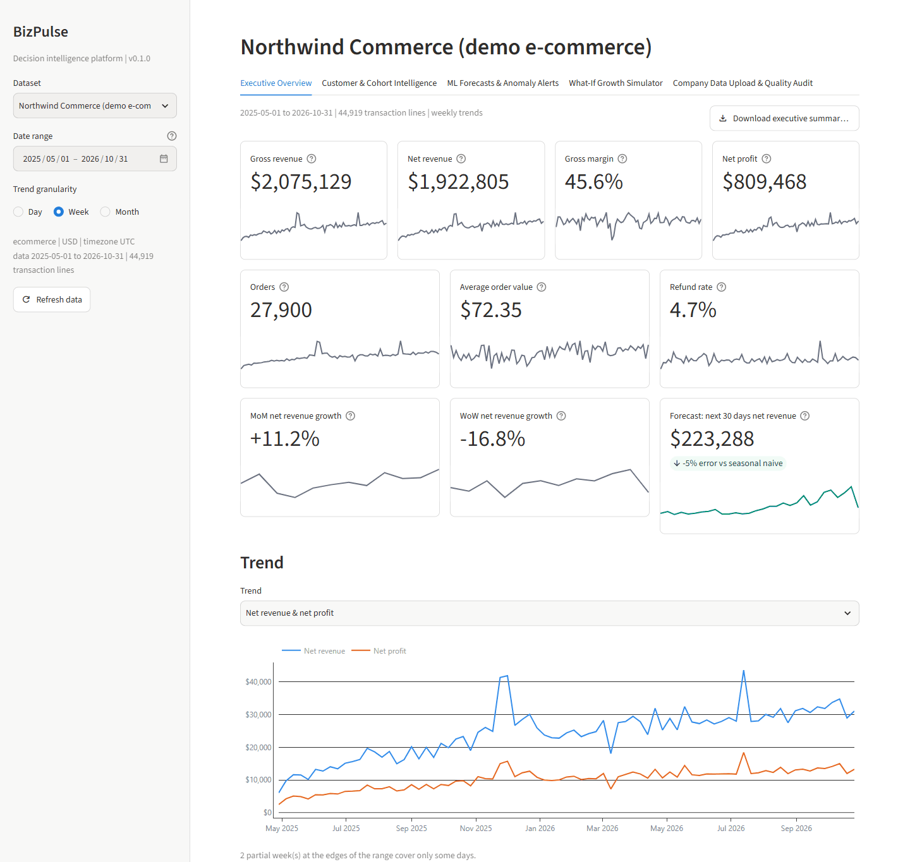
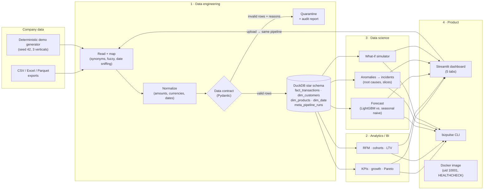
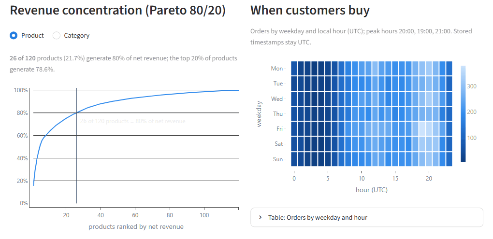
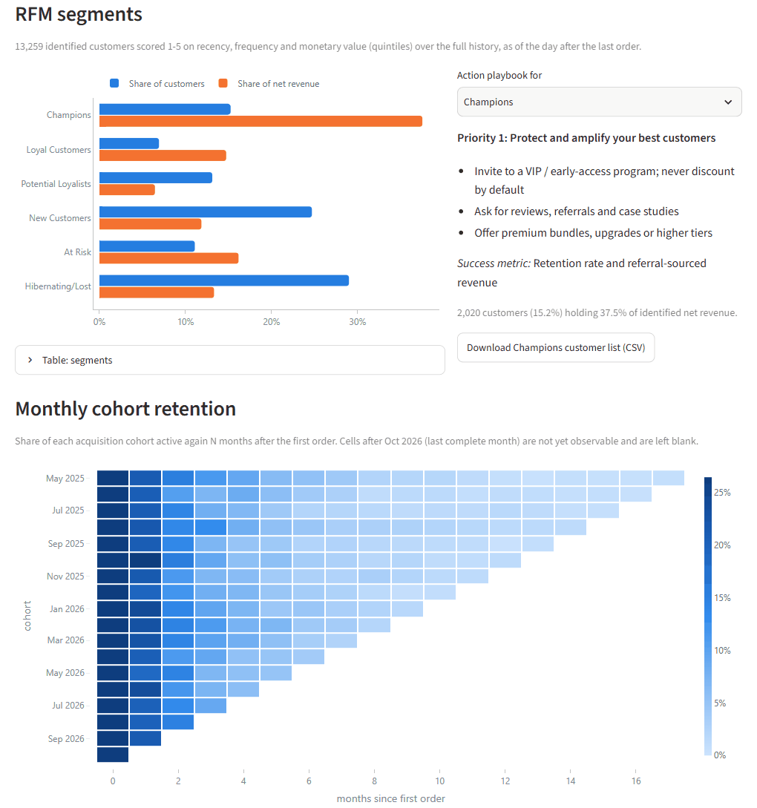
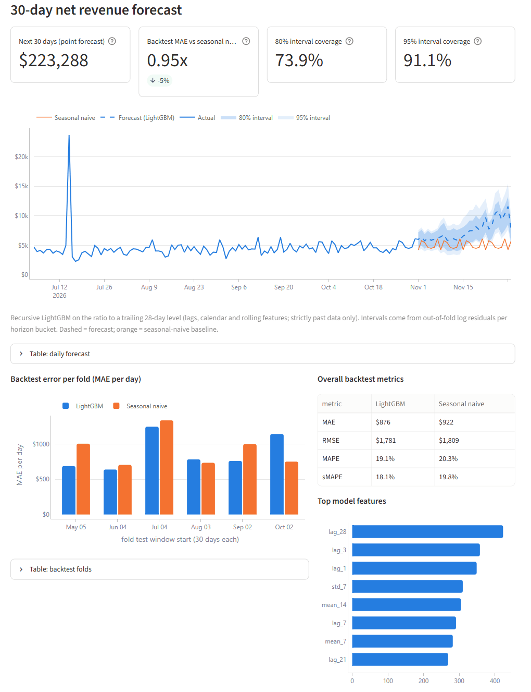
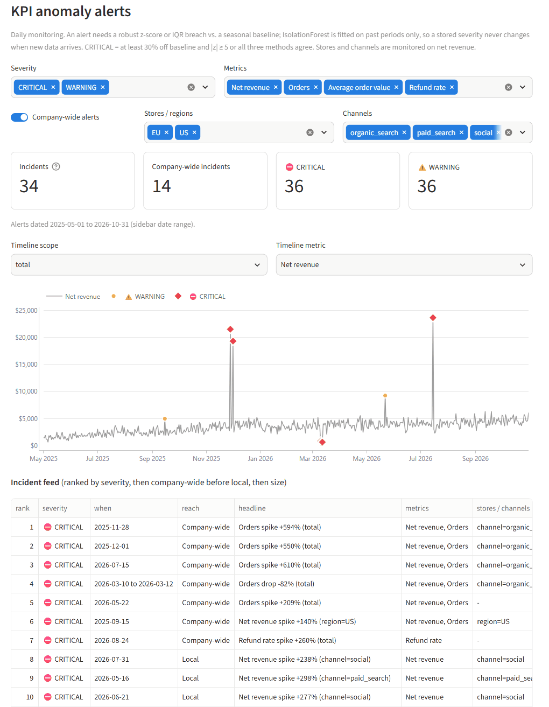
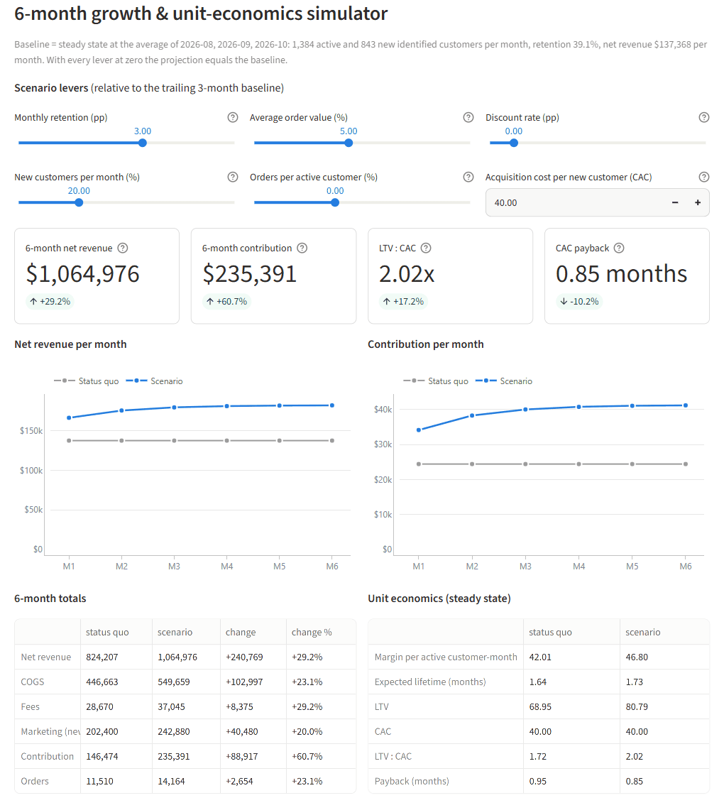
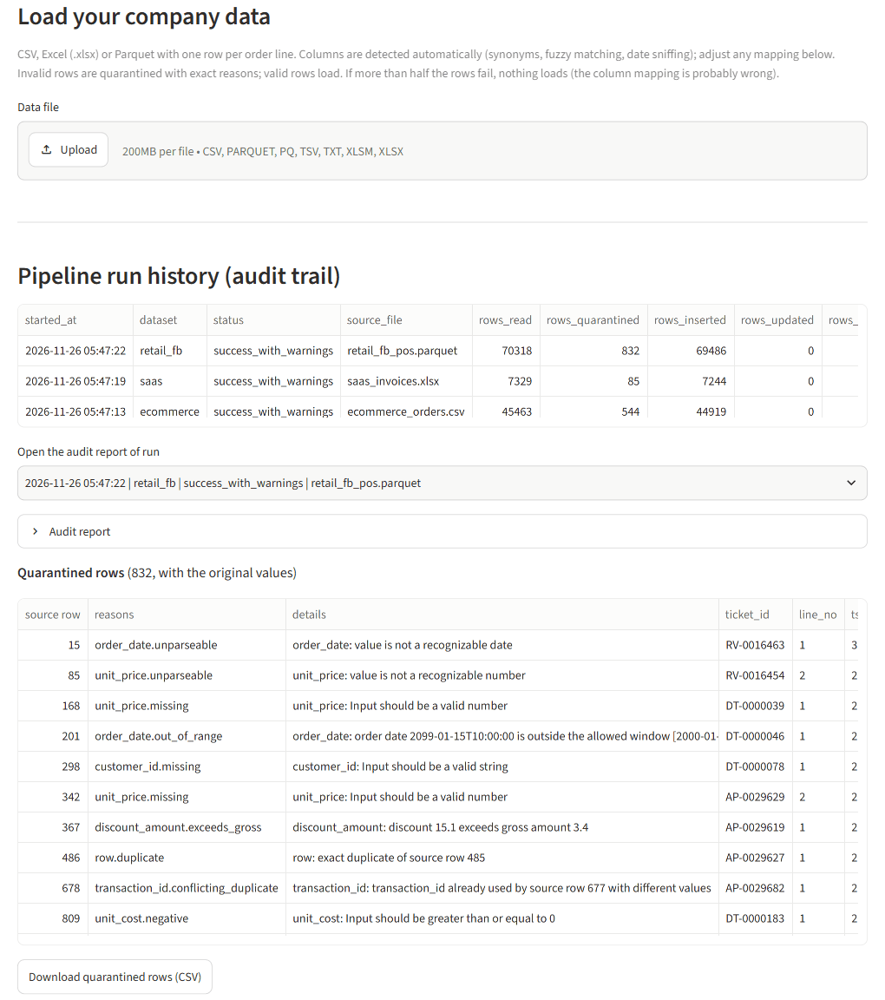

# BizPulse Platform

A domain-agnostic **decision intelligence platform** for startups and small companies.
It ingests messy sales or billing exports (CSV, Excel, Parquet) through strict data
contracts into a DuckDB star schema. From there it answers the questions founders,
growth, finance and data people actually ask:

- Are we growing profitably?
- Which customers do we keep, win back or upsell?
- What will next month look like?
- What changed, and where?
- What if we change pricing or retention?

It works for any vertical through column mapping. Three demo businesses ship with it:
an e-commerce shop, a SaaS company and a cafe chain.

<picture>
  <source media="(prefers-color-scheme: dark)" srcset="docs/images/overview-dark.png">
  
</picture>

*The Executive Overview on the bundled demo e-commerce data. Every screenshot in this
README is the real dashboard running on that data, and this one follows your GitHub
light or dark theme.*

| Layer | What it does |
| --- | --- |
| **Data engineering** | Multi-format ingestion with column auto-detection; currency / date / type normalization; a Pydantic data contract that quarantines bad rows with exact reasons; idempotent SHA-256-keyed loads; a DuckDB star schema with run lineage; JSON + Markdown data-quality audit reports. |
| **Analytics / BI** | Gross and net revenue, gross margin, net profit, orders, AOV, MoM/WoW growth and refund rate; Pareto 80/20; RFM segments with action playbooks; monthly cohort retention; empirical LTV; hour-of-day in each business's own timezone. |
| **Data science** | Leak-free LightGBM revenue forecast vs. a seasonal-naive baseline (`TimeSeriesSplit` backtest, 80/95 % intervals). KPI anomaly detection (robust z-score, IQR, expanding-window IsolationForest) with CRITICAL/WARNING severities, store/channel slices, root-cause attribution and severity-ranked incident grouping. A 6-month what-if and unit-economics simulator. |
| **Product** | `bizpulse` CLI, a 5-tab Streamlit + Plotly dashboard, and a non-root Docker image with a health check. |

## Architecture



Layers depend only downward. Analytics and ML read the warehouse through short-lived,
read-only connections. Dashboard uploads go through the same `run_pipeline()` as the
CLI. Details are in [docs/ARCHITECTURE.md](docs/ARCHITECTURE.md).

## Quick start

Requirements: [uv](https://docs.astral.sh/uv/) (Python 3.12 is pinned and installed by
uv). Docker is optional.

```bash
uv run python tasks.py setup           # sync the environment, verify imports
uv run python tasks.py generate-demo   # 3 deterministic demo datasets (seed 42, 18 months)
uv run python tasks.py run-pipeline    # ingest -> validate -> quarantine -> DuckDB star schema
uv run python tasks.py dashboard       # http://localhost:8501
```

Or in Docker. The image ships with the demo warehouse, so the dashboard has data
immediately:

```bash
uv run python tasks.py docker-build    # or: docker build -t bizpulse-platform .
docker run --rm -p 8501:8501 bizpulse-platform
docker run --rm bizpulse-platform bizpulse report --dataset ecommerce
```

A `Makefile` mirrors every `tasks.py` command (`make check`, `make dashboard`, ...).
Parity between the two is itself a checked gate.

## Load your own data

Files are mapped to one canonical order-line contract:

- **Required:** `transaction_id`, `order_date`, `customer_id`, `product_id`, `quantity`,
  plus `unit_price` or `line_total`.
- **Optional:** `order_id`, `product_name`, `category`, `channel`, `region`, `status`,
  `discount_amount`, `unit_cost`, `fee_amount`, `currency`.

Headers are matched by synonym, fuzzy matching or date sniffing, and any of them can be
pinned in a YAML/JSON mapping.

```bash
uv run bizpulse run-pipeline --file my_orders.csv --dataset acme          # auto-detect
uv run bizpulse run-pipeline --file my_orders.xlsx --mapping acme.yaml    # pinned mapping
uv run bizpulse status                                                    # warehouse overview
```

The dashboard's **Company Data Upload & Quality Audit** tab does the same interactively:
upload, preview, edit the detected mapping, load, then inspect the audit report and every
quarantined row.

How a run handles bad data:

- Invalid rows are quarantined with reason codes such as `order_date.unparseable` or
  `quantity.non_positive`, and valid rows still load.
- If more than 50 % of the rows fail, nothing loads, because the mapping is probably
  wrong.
- Re-sending the same file is `skipped`, and changed rows update only those rows.
- Hostile values are quarantined, never loaded. This covers `NaN`, `inf`, `1e400`,
  impossible dates, negative quantities and blank IDs.

## CLI

| Command | Purpose |
| --- | --- |
| `bizpulse generate-demo [--scale 1.0] [--seed 42]` | deterministic demo data: CSV, Excel, Parquet, plus ground-truth manifests |
| `bizpulse run-pipeline --all \| --file F (--dataset D \| --mapping M) [--force]` | ingest, validate, quarantine, load, compact |
| `bizpulse status` | warehouse size, datasets, row counts, date ranges, last runs |
| `bizpulse runs [--dataset D]` | pipeline run history (lineage) |
| `bizpulse report [--dataset D] [--json PATH] [--markdown PATH]` | KPIs, growth, Pareto, mix, RFM actions, LTV, forecast backtest, ranked incidents; JSON export or a Markdown executive summary |
| `bizpulse forecast --dataset D [--horizon 30] [--csv PATH]` | daily forecast with 80/95 % bands and backtest metrics |
| `bizpulse whatif --dataset D --retention-pp 2 --aov-pct 5 --cac 40` | 6-month scenario vs. status quo and unit economics |
| `bizpulse smoke` | end-to-end self-test on small demo data plus hostile input, in an isolated temp dir |
| `bizpulse dashboard [--port 8501] [--demo-if-empty]` | start the dashboard |

## Dashboard

1. **Executive Overview.**
   - KPI tiles with sparklines and the change vs. the previous period: gross revenue, net
     revenue, gross margin, net profit, orders, AOV, refund rate.
   - MoM and WoW growth, and a 30-day forecast tile.
   - A revenue-and-profit trend.
   - Pareto 80/20 by product or category.
   - Orders by local weekday and hour, and channel/category/region mix.
   - A downloadable executive summary.

   
2. **Customer & Cohort Intelligence.**
   - RFM segments, comparing share of customers with share of revenue.
   - An action playbook per segment, plus a customer-list CSV.
   - A cohort retention heatmap.
   - LTV curves.

   
3. **ML Forecasts & Anomaly Alerts.**
   - The forecast with 80/95 % intervals and the seasonal-naive baseline.
   - MAE / RMSE / MAPE / sMAPE vs. the baseline, per-fold errors and top features.
   - Alerts filtered by severity, metric, company-wide and store/channel.
   - A **severity-ranked incident feed**. Alerts on adjacent days are grouped, so a broad
     outage reads as one line, not twenty.
   - An incident drill-down with root-cause bars.

   

   
4. **What-If Growth Simulator.**
   - Retention, AOV, discount, acquisition and frequency levers, plus a CAC input.
   - Status quo vs. scenario for net revenue and contribution.
   - Unit economics: LTV, LTV:CAC and payback.

   

   *The scenario shown: retention +3 pp, AOV +5 %, new customers +20 %, CAC $40.*
5. **Company Data Upload & Quality Audit.**
   - Upload, mapping editor, validation and load.
   - The audit report and the full quarantined-rows table, with JSON/Markdown/CSV
     downloads.
   - Run history.

   

How the dashboard behaves:

- **Rendering.** Tabs render lazily, and results are cached per warehouse version.
- **Colors.**
  - Each color has one job: identity, magnitude, or status.
  - Red and amber are reserved for CRITICAL and WARNING, always with an icon and a label.
  - Light and dark mode use separately validated steps.
- **Accessibility.** Every chart has a table view.
- **Small or partial data.** Empty slices, missing optional columns and tiny datasets
  show explanations instead of errors.

## Measured results

The data is the full-scale demo data (seed 42, 2025-05-01 → 2026-10-31). Timings were
measured on this Windows 11 machine with Python 3.12.

**Forecasting.** 6 rolling 30-day `TimeSeriesSplit` folds; criteria registered before
the first run, no tuning:

| Dataset | LightGBM MAE | Seasonal-naive MAE | Ratio | 80 % interval coverage | 95 % interval coverage |
| --- | ---: | ---: | ---: | ---: | ---: |
| ecommerce (USD/day) | 876 | 922 | **0.95** | 73.9 % | 91.1 % |
| retail_fb (EUR/day) | 85.7 | 104.5 | **0.82** | 71.7 % | 89.4 % |
| saas (USD/day) | 5,763 | 7,835 | **0.74** | 72.8 % | 90.0 % |

**Anomaly detection.** The generator plants 7 day-level ground-truth incidents:

- a checkout outage, a refund spike and a viral social day (e-commerce);
- a store closure, a POS outage and a BOGO promo (cafes);
- a one-off enterprise deal (SaaS).

An eighth incident, a month-level SaaS churn spike, is documented but out of daily and
weekly scope.

- **Recall: 7/7.** Each is detected on its metric inside its window, with the correct root
  cause or scope.
- **Immutability:** a stored severity never changes when new data arrives. This is
  asserted by a test.
- **Quiet data:** synthetic data with no incidents never produces a CRITICAL. Also
  asserted.
- **Incident grouping:** in retail_fb, 55 alerts become 33 ranked incidents.

**Data quality and ingestion.**

- The generator plants about 1–2 % dirty rows, each with exactly one defect.
- The quarantine equals the ground-truth manifest **row for row, reason for reason**.
- Pass rates: 98.80 % (ecommerce), 98.84 % (saas), 98.82 % (retail_fb).
- Throughput, including normalization, contract validation and the transactional load:

  | Dataset | Format | Rows | Time | Throughput |
  | --- | --- | ---: | ---: | ---: |
  | ecommerce | CSV | 45,463 | 5.9 s | about 7,700 rows/s |
  | retail_fb | Parquet | 70,318 | 9.2 s | about 7,600 rows/s |
  | saas | Excel | 7,329 | 3.0 s | about 2,500 rows/s (the Excel reader is the bottleneck) |

- Re-loading an identical file is skipped after a file-hash check, without
  re-processing.
- The warehouse is 22 MB after compaction. All generated artifacts total about 29 MB,
  under the 50 MB budget.

**KPI snapshot.**

| Dataset | Net revenue | Gross margin | Other figures |
| --- | ---: | ---: | --- |
| ecommerce | $1.92M | 45.6 % | AOV $72.35; 26 of 120 products = 80 % of revenue |
| saas | $3.56M | 76.9 % | |
| retail_fb | €305k | 73.7 % | peak local hours 08:00 and 13:00 (Europe/Berlin; UTC storage would suggest 06:00 / 11:00) |

**Model and dashboard timings.**

| Operation | Time |
| --- | ---: |
| Forecast with backtest | 1.2–1.4 s per dataset |
| Anomaly scoring | 2.5–5.8 s per dataset |
| Dashboard tabs | 0.1–2.5 s for BI tabs, up to 4.7 s the first time the ML tab opens (cached afterwards) |

**Tests and container.**

- **Tests:** 253 pass, with no `xfail`. Coverage is 95 % (statements + branches). They
  cover:
  - unit, component and integration tests;
  - the CLI;
  - the dashboard through Streamlit `AppTest`: every tab × every dataset, the upload
    flow, and hostile uploads;
  - the full-scale ML acceptance criteria.
- **`bizpulse smoke`:** 9 end-to-end checks in about 20 s:
  - all three formats;
  - quarantine vs. manifest;
  - idempotency;
  - the quality gate;
  - hostile input;
  - compaction;
  - analytics, forecast, anomalies and what-if per dataset.
- **`tasks.py docker-smoke`:** it checks that:
  - the container runs as uid 10001;
  - `bizpulse --version` works;
  - `bizpulse smoke` passes inside the image;
  - the HEALTHCHECK reaches `healthy`;
  - the dashboard answers on the host.

  It finishes in about 1 min with a warm build cache, or 3–4 min cold.
- **Container startup:** the image is 1.11 GB, of which the Python environment is 659 MB
  and pyarrow alone 166 MB.
  - It reports healthy about 12 s after start.
  - With an empty volume mounted over `/app/data`, it rebuilds the demo data first and
    reports healthy after about 44 s.

## Design trade-offs

| Decision | Why | Cost accepted |
| --- | --- | --- |
| DuckDB single-file star schema | columnar OLAP speed, ACID, zero ops, native pandas interop | single writer; not a multi-tenant server |
| 64-bit SHA-256-derived surrogate keys, plus a full SHA-256 row hash for change detection | deterministic and idempotent across machines; warehouse 58 MB → 22 MB vs. hex keys | collision odds ≈ N²/2⁶⁵ (≈ 3e-8 at 1M rows); a collision fails loudly on the primary key, never merges rows |
| Quarantine instead of reject, with a 50 % gate | one bad row never blocks a load, but a wrong mapping can't half-load a file | the threshold is a judgment call (configurable per mapping) |
| Naive UTC storage + per-dataset timezone at query time | canonical, comparable timestamps; correct local hour-of-day (a café's 08:00 peak, not 06:00) | every hour-of-day view must localize explicitly |
| Recursive LightGBM on a ratio-to-level target | learns weekly / annual shape and scales with the business; strictly past-only features | 18 months teach a once-a-year peak from a single occurrence |
| Rule-based + expanding-window IsolationForest anomalies | explainable (z-score, IQR), severities never change after the fact | two post-hoc amendments were needed; severity grading is weaker than detection |
| Weekly monitoring for SaaS | billing calendars make daily totals lumpy (days 29–31) | a one-day SaaS incident surfaces at week granularity |
| Steady-state what-if on trailing 3-month averages | transparent and exactly reproducible (zero levers = baseline) | a reasoning tool, not a forecast; CAC is an explicit assumption |
| Demo warehouse baked into the image | instant, deterministic first start | about 30 MB in the image; `--demo-if-empty` rebuilds it on an empty volume |

## Engineering standards

`uv run python tasks.py check` runs every gate, and each must pass:

- **eol:** LF line endings, checked on the working-tree bytes.
- **hygiene:** no secrets, personal emails or local machine paths.
- **makefile-sync:** Makefile parity with `tasks.py`.
- **lint and format:** `ruff`.
- **typecheck:** `mypy --strict` over `src/`, `tests/` and `tasks.py`.
- **size:** generated data stays under 50 MB.

Beyond that, `tasks.py test` runs pytest and `tasks.py docker-smoke` builds the image
and verifies it. Everything is reproducible:

- The demo data is seeded and its window is fixed.
- Surrogate keys are deterministic.
- The models are seeded.
- The wall clock is never used for analysis dates.

## Limitations

- **The anomaly rule was amended after the fact.** The pre-registered rule reached 4/7.
  Two approved and documented amendments brought recall to 7/7
  ([TECHNICAL-REQUIREMENTS §7.1](docs/TECHNICAL-REQUIREMENTS.md)). Severity agreement
  with the planted expectations is **3/7**. Detection is reliable; the CRITICAL vs.
  WARNING grading is not yet.
- **The intervals are slightly narrow.** About 72–74 % of days fall inside the nominal
  80 % band, and about 89–91 % inside the 95 % band.
- **18 months cannot teach a model a once-a-year event.** For example, a Black Friday
  peak is learned from a single occurrence.
- **CAC is not in the data.** It is an explicit input, and LTV:CAC and payback depend
  entirely on it.
- **FX rates are a static reference table,** for reproducibility.
- **Single-node design.** DuckDB is a single file, and the dashboard is intended for one
  team.

## Documentation

- [Architecture](docs/ARCHITECTURE.md)
- [Design](docs/DESIGN.md): data contract, mapping heuristics, keys, dashboard design.
- [Technical requirements](docs/TECHNICAL-REQUIREMENTS.md): KPI formulas, ML rules and
  amendments.
- [App flow](docs/APP-FLOW.md)
- [Implementation plan](docs/IMPLEMENTATION-PLAN.md): with measured results per phase.
- [Testing guide](docs/TESTING-GUIDE.md)
- [CLAUDE.md](CLAUDE.md): engineering rules for AI-assisted sessions.

## License

MIT. See [LICENSE](LICENSE).
